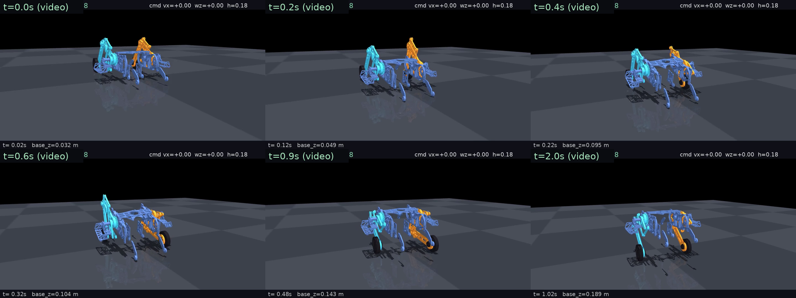

# v14 轮腿机器人 · 完整闭链模型 RL 训练成果 + 部署交接包

> 一个**可以直接交给第三方部署**的策略包：从趴卧姿自主起身 → 保持平衡 → 站/走/转/高度跟踪。
> 训练物理 = 部署物理：**v14 完整闭链模型**（15 link、4 条 `<connect>`、14.189 kg、含底部导轮几何），
> 用 mjlab / MuJoCo Warp GPU 训练（不是旧的「后链串联等效」简化模型）。

## 内容

| 文件/目录 | 说明 |
| --- | --- |
| [`AI_HANDOFF_PROMPT.md`](AI_HANDOFF_PROMPT.md) | **给接手 AI 的任务说明（可直接复制）** |
| [`README_ZH.md`](README_ZH.md) | 交接总览：自检、部署要点、已知限制、文件清单 |
| [`INTERFACE.md`](INTERFACE.md) | 精确接口合同：ONNX 输入/历史布局/25 维观测/动作解码/闭链力矩映射/硬件映射 |
| [`policy/`](policy/) | `v14_rise_wide_deploy.onnx`（**v1.1 推荐，宽指令**）+ `v14_rise_deploy.onnx`（v1.0）+ `v14_full_closed_deploy.onnx` |
| [`model/`](model/) | 完整 v14 闭链 MJCF（场景/网格/URDF），与训练/验收同一份 |
| [`runtime/`](runtime/) | 参考运行时：观测组装+推理+动作解码+闭链力矩映射、闭链运动学、已验收的闭环回放、自检脚本 |
| [`evidence/`](evidence/) | 5 组 ONNX 数值测试向量、来源/哈希/训练配置存档 |
| [`reports/`](reports/) | 完整训练报告 + sim2sim 验收数据 |
| [`media/`](media/) | 起身分帧图、GIF、4 场景闭环录像 |
| [`training_scripts/`](training_scripts/) | BC 蒸馏 / 教师轨迹采集 / 快照生成脚本（可选） |

## 快速自检

```bash
pip install -r runtime/requirements.txt
python runtime/verify_package.py          # 期望 PASS
python runtime/sim2sim_replay.py --onnx policy/v14_rise_deploy.onnx \
    --no-viewer --duration 10 --init prone   # 期望从趴卧起身，末态 h≈0.190 m、倾斜≈1.3°
```

## 已验证（完整闭链 MuJoCo，40/40/20 N·m）

**v1.3（折中档，`v14_rise_anneal_deploy.onnx`）**：DR 课程退火（强 DR→弱 DR→无 DR）后，
标称 |vx 误差| **0.0396**（v1.2 0.0626、v1.1 0.0349），DR 组合速度误差标准差 **0.0247**
（v1.1 0.0499、v1.2 0.0135）；同时新增**变高度功能**（0.14–0.21 m 平滑改变，站立实测平均误差 6.0 mm、
过渡 0.20–0.37 s）。详见 `reports/anneal_cmd_matrix.md` 与 `reports/height_change.md`。

**v1.2（鲁棒档，`v14_rise_dr_deploy.onnx`）**：强域随机化训练（质量/质心/摩擦/关节/电机/kp/kd/滞后/
动作延迟/推力/编码器偏置/趴卧姿态）；DR 分布内随机组合 12/12 起身，速度跟踪误差标准差
**-73%**、最大误差 -54%，单项扰动与推力恢复 PASS。详见 `reports/robust_cmd_matrix.md`。

**v1.1（性能档，`v14_rise_wide_deploy.onnx`）**：从趴卧姿 22 条宽指令矩阵 **22/22 PASS** ——
vx ±1.5 m/s、wz ±1.2 rad/s、高度 0.14–0.21 m；平均 |vx 误差| **0.035**、|wz 误差| **0.020**、
|高度误差| **0.003 m**，起身 **0.34–0.50 s**；扰动种子 1/7/42 也 PASS。详见 `reports/wide_cmd_matrix.md`。

**v1.0（`v14_rise_deploy.onnx`）**：起身 0.50 s、末态 0.1888–0.2018 m、保持 0.95，4/4 PASS + 3 扰动种子。



## 重要提醒（详见 `README_ZH.md` §4/§6）

- **力矩口径必须 40/40/20 N·m**：±3.14 口径下任何策略都站不住（站立静力需后髋约 17 N·m）。
- 现有 H723 板载 C 推理是 `encoder+actor` 双输入结构，与本策略（单输入 `125→256³→6` MLP）
  **不兼容**，上板需重新生成权重/改网络；先用 `evidence/test_vectors.json` 对齐数值。
- 仅在 MuJoCo 完整闭链模型上验证，**实车未验证**；编码器零位/方向、力矩换算仍是参考值。

## 训练来源

训练工作区、失败尝试诊断与复现命令见 [`reports/TRAINING_REPORT.md`](reports/TRAINING_REPORT.md)；
策略 sha256、来源 checkpoint、训练方法见 [`evidence/provenance.json`](evidence/provenance.json)。
